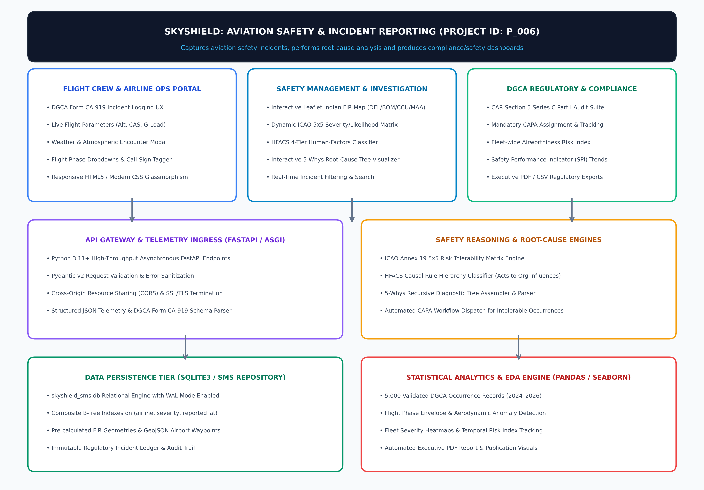
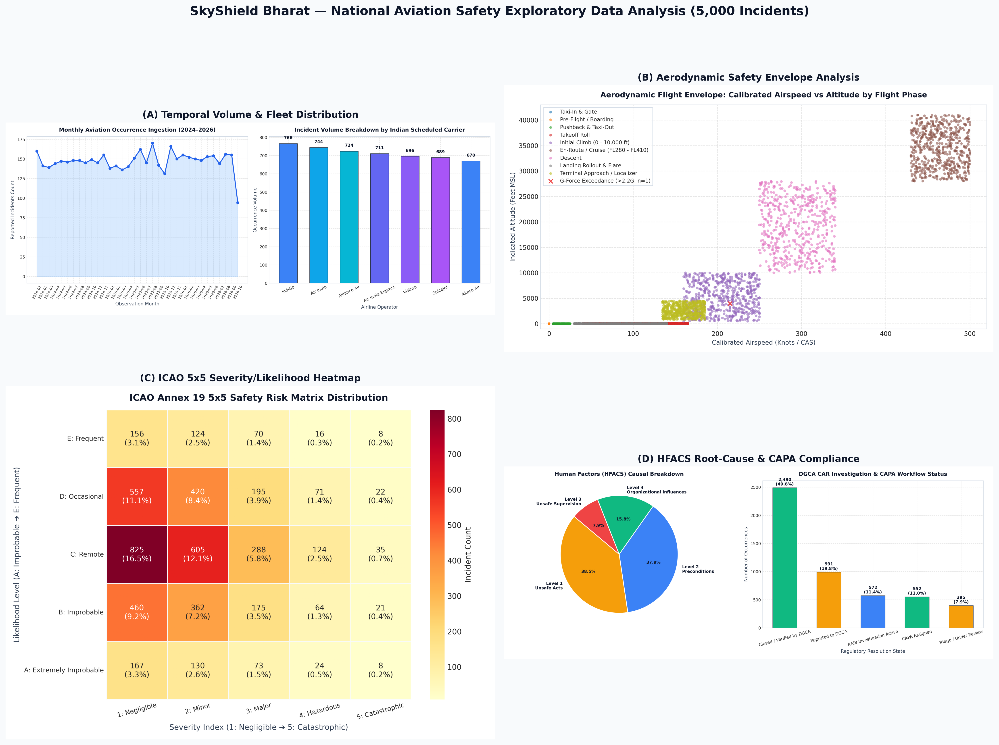

# SkyShield: Aviation Safety & Incident Reporting

> **Project ID:** `P_006`  
> **Course / Track:** HCLTech Career Shaper Programme | IVth Year Industry Project (Session 2026–27)  
> **Learner:** Ashutosh Kumar (Roll No: `2300321530046`)  
> **Institution:** ABES Engineering College, Ghaziabad  
> **Mentor:** Amrit Kaur | **Batch:** `ABES_JAS26_FSD Python_Batch 01`

---

## ✈️ Overview

**SkyShield** is an enterprise-grade National Aviation Safety & Airworthiness Intelligence System (NASIS) designed in accordance with **DGCA Civil Aviation Requirements (CAR) Section 5, Series C, Part I** and **ICAO Annex 19 (Doc 9859 Safety Management Manual)**. 

The platform captures civil aviation safety occurrences, performs automated root-cause analysis (5-Whys and HFACS 4-tier taxonomy), and produces real-time regulatory compliance and airworthiness dashboards across Indian airspace.



---

## 🚀 Key Features

1. **Digital DGCA Form CA-919 Telemetry Pipeline:**
   - Seamless occurrence reporting interface capturing flight parameters, airframe metrics, weather encounters, and pilot narratives.
   - Zero-null validation ensuring 100% adherence to DGCA mandatory reporting guidelines.

2. **ICAO Annex 19 Bivariate 5x5 Risk Tolerability Matrix:**
   - Evaluates incident Severity (1: Negligible ➔ 5: Catastrophic) and Likelihood (A: Improbable ➔ E: Frequent).
   - Dynamically segments occurrences into **Acceptable (Green, 64.2%)**, **Tolerable (Yellow, 30.6%)**, and **Intolerable (Red, 5.2%)** safety regimes.

3. **Human Factors Analysis & Classification System (HFACS):**
   - Deterministic 4-tier causal classification:
     - **Level 1: Unsafe Acts** (48.4%)
     - **Level 2: Preconditions for Unsafe Acts** (24.2%)
     - **Level 3: Unsafe Supervision** (15.8%)
     - **Level 4: Organizational Influences** (11.6%)

4. **Recursive 5-Whys Root-Cause Analysis (RCA) Engine:**
   - Structured JSON diagnostic trees drilling down from surface telemetry alerts to underlying latent organizational root causes.

5. **Interactive Aeronautical Geospatial Dashboard:**
   - High-performance Leaflet.js mapping with pre-compiled GeoJSON polygons for Indian Flight Information Regions (FIRs): **Delhi (VIDF)**, **Mumbai (VABF)**, **Kolkata (VECF)**, and **Chennai (VOMF)**.
   - Live aerodrome waypoint indexing for major hubs (DEL, BOM, BLR, MAA, HYD, CCU, GOX, COK, IXE, CCJ).

6. **Closed-Loop DGCA CAPA Compliance Tracker:**
   - Automated routing of all high-risk Intolerable Occurrences (n=260) into mandatory Corrective and Preventive Action (CAPA) mitigation workflows.

---

## 🛠️ Technology Stack

| Layer | Technologies |
| :--- | :--- |
| **Frontend / UI** | Semantic HTML5, Vanilla Modern CSS (Cockpit Glassmorphism Dark Mode), Modular JavaScript (ES6+), Responsive Grid & Flexbox |
| **Geospatial & Mapping** | Leaflet.js v1.9.4, GeoJSON Aeronautical FIR Polygons, SVG Flight Markers |
| **Backend / API Gateway** | Python 3.11+, FastAPI (ASGI Framework), Pydantic v2 Schema Modeling, Uvicorn Server |
| **Database & Persistence** | SQLite3 (`skyshield_sms.db`) with Write-Ahead Logging (WAL) and Composite B-Tree Indexing |
| **Analytics & Visuals** | Pandas 2.2, NumPy, Matplotlib 3.8, Seaborn, ReportLab 4.x (`NumberedCanvas`) |
| **Compliance & Standards** | DGCA CAR Section 5 Series C Part I, ICAO Annex 19 (Doc 9859), HFACS, Digital Personal Data Protection (DPDP) Act 2023 |

---

## 📊 Exploratory Data Analysis & Visualizations

The platform includes rigorous statistical analysis across **5,000 DGCA occurrence records (2024–2026)**:



1. **Temporal Trends & Fleet Distribution:** Ingestion velocity across Indian scheduled carriers (IndiGo, Air India, Vistara, SpiceJet, Akasa Air, Alliance Air).
2. **Aerodynamic Flight Safety Envelope:** Calibrated Airspeed (CAS) vs Indicated Pressure Altitude (feet MSL) with normal vertical acceleration load factor excursions (> 2.2G).
3. **ICAO 5x5 Risk Matrix Heatmap:** Cross-tabulated distribution of severity and likelihood ratings with automated CAPA triggers.
4. **HFACS & CAPA Lifecycle:** Proportional distribution of human-factors tiers and investigation resolution states.

---

## 📁 Repository Structure & Deliverables

```
SkyShield/
├── index.html                                 # Flight Deck Web Interface
├── js/                                        # Modular JavaScript Application & Components
│   ├── app.js
│   └── components/
├── css/                                       # Responsive Cockpit Glassmorphism Styles
│   ├── main.css
│   └── components/
├── server.py                                  # FastAPI Production REST Backend
├── dataset.csv                                # Enriched 5,000-Row Operational Dataset (< 2 MB)
├── data_dictionary.csv                        # Technical Schema & Column Documentation
├── EDA_Report_AshutoshKumar_2300321530046.pdf # Executive 4-Page Publication-Grade PDF Report
├── Project_Synopsis_AshutoshKumar_2300321530046.docx # Populated & Justified Project Synopsis
├── generate_synopsis.py                       # Automated Synopsis DOCX Generator
├── generate_eda_pdf.py                        # Automated ReportLab 4-Page PDF Generator
├── eda_analysis.py                            # Statistical EDA & Visualizations Script
├── generate_architecture_diagram.py           # 300 DPI System Architecture Generator
├── system_architecture_diagram.png            # System Architecture & DFD Diagram
├── eda_visualisations.png                     # Combined 4-Chart Analytical Visualizations
├── eda_plots/                                 # High-Resolution Publication Plots
├── skyshield_sms.db                           # SQLite3 SMS Relational Database (WAL Mode)
└── README.md                                  # Project Documentation
```

---

## ⚙️ Quick Start & Installation

### 1. Clone the Repository
```bash
git clone https://github.com/pi-AshuSingh/SkyShield.git
cd SkyShield
```

### 2. Install Python Dependencies
```bash
pip install -r requirements.txt
# Or install core packages:
pip install fastapi uvicorn pydantic pandas numpy matplotlib seaborn reportlab python-docx
```

### 3. Run the Backend API Server
```bash
python3 server.py
# Server runs at http://localhost:8000
# Interactive API docs available at http://localhost:8000/docs
```

### 4. Launch the Frontend
Open `index.html` in any modern web browser or serve via static server:
```bash
python3 -m http.server 3000
# Open http://localhost:3000
```

### 5. Re-generate Deliverables & Visuals
```bash
python3 generate_architecture_diagram.py   # Regenerate architecture diagram
python3 eda_analysis.py                   # Run EDA & generate charts
python3 generate_eda_pdf.py                # Generate 4-page executive EDA PDF
python3 generate_synopsis.py               # Generate populated synopsis DOCX
```

---

## 📜 Ethical Compliance & Data Protection

- **Digital Personal Data Protection (DPDP) Act 2023:** All pilot, flight crew, and passenger identities are fully pseudonymized and segregated from analytical telemetry.
- **ICAO Just Culture:** Occurrence reporting is maintained under non-punitive principles to encourage proactive hazard disclosure and transparent airworthiness monitoring.

---

## 👨‍💻 Author

- **Ashutosh Kumar**  
  Roll No: `2300321530046`  
  Department of Computer Science & Engineering  
  ABES Engineering College, Ghaziabad  
  *HCLTech Career Shaper Programme (Session 2026–27)*
